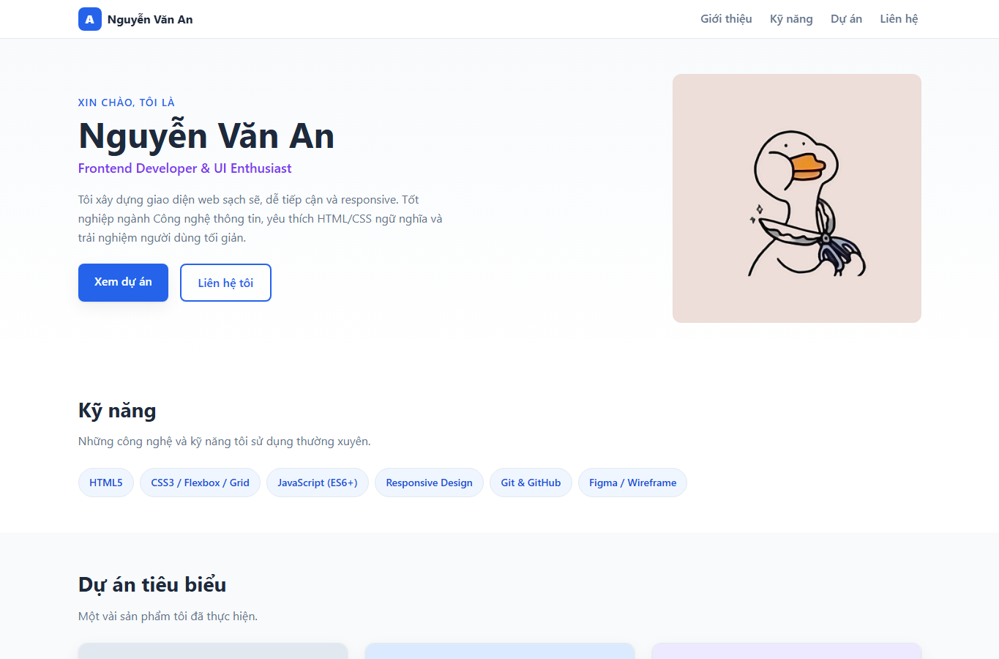
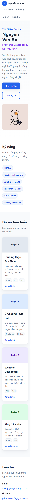

# Báo cáo kiểm thử

- **Dự án:** Portfolio CV - Nguyễn Văn An
- **Ngày kiểm thử:** 27/10/2026
- **Phạm vi:** Website tĩnh trong repository; kiểm tra trực quan bằng Microsoft Edge/Chromium trên Windows và rà soát mã nguồn.
- **Kết quả tổng quan:** Trang hiển thị đúng trong các kích thước đã kiểm tra. Một số tiêu chí chỉ đạt một phần vì dự án không có bộ kiểm thử tự động, máy chủ ứng dụng hoặc môi trường Docker khả dụng để xác minh triển khai.

## Kết quả theo tiêu chí

| Tiêu chí | Kết quả | Kết quả kiểm tra và ghi chú |
|---|---|---|
| **Tính đúng đắn** | Đạt | Trang mở được; tiêu đề và bốn khu vực Giới thiệu, Kỹ năng, Dự án, Liên hệ hiện diện. Có 4 thẻ dự án. Cả 5 ảnh và stylesheet đều tải thành công. Các liên kết điều hướng trỏ đến các phần tương ứng có trong trang. |
| **UI/UX** | Đạt trong phạm vi đã kiểm tra | Đã chụp giao diện ở màn hình máy tính 1365 × 900 và toàn trang ở chiều rộng viewport 390 CSS px. Bố cục thích ứng; kiểm tra ở viewport 390 CSS px không phát hiện tràn ngang. Có văn bản thay thế cho ảnh và trạng thái focus nhìn thấy được trong CSS. Chưa thực hiện đánh giá khả năng tiếp cận chuyên sâu. |
| **Khả năng vận hành - xử lý lỗi** | Đạt một phần | Trang tĩnh và tài nguyên hiển thị bình thường khi mở cục bộ. Dự án không có mã xử lý lỗi phía ứng dụng, máy chủ hay biểu mẫu; chưa kiểm thử tình huống phục vụ lỗi, mất mạng hoặc thiếu tài nguyên. |
| **Bảo mật** | Đạt trong phạm vi rà soát cơ bản | Rà soát mã nguồn cho thấy trang không có JavaScript chạy phía client, biểu mẫu nhập liệu, xử lý dữ liệu người dùng hoặc dịch vụ backend; stylesheet được lưu cục bộ. Đây không phải kiểm thử xâm nhập hay đánh giá bảo mật chuyên sâu. |
| **Chất lượng mã nguồn** | Đạt một phần | HTML dùng các khu vực ngữ nghĩa, ảnh có `alt`, CSS được tách riêng và có breakpoint responsive. Chưa chạy HTML/CSS validator, linter hoặc bộ kiểm thử tự động; repository hiện không có cấu hình build/test cho website. |
| **Khả năng triển khai** | Đạt một phần | Có thể mở trực tiếp `index.html`; README cũng hướng dẫn phục vụ bằng máy chủ tĩnh và Docker/Nginx. Chưa xác minh triển khai qua HTTP, nền tảng hosting hoặc Docker trong lần kiểm thử này; Docker không khả dụng trong môi trường kiểm thử và repository không có Dockerfile. |

## Minh chứng hình ảnh

Ảnh được chụp trực tiếp từ trang chạy trong trình duyệt, không chỉnh sửa nội dung giao diện.

### Máy tính — viewport 1365 × 900

### Điện thoại — viewport 390 CSS px

## Giới hạn của lần kiểm thử

- Chỉ kiểm tra giao diện trong Microsoft Edge/Chromium trên Windows; chưa kiểm tra chéo trên macOS, Linux hoặc các trình duyệt khác.
- Chưa có bộ test tự động, kiểm tra hiệu năng, xác thực HTML/CSS hay đánh giá bảo mật chuyên sâu.
- Nội dung liên hệ và liên kết dự án trên trang là dữ liệu mẫu; cần thay bằng thông tin thực tế trước khi phát hành.
